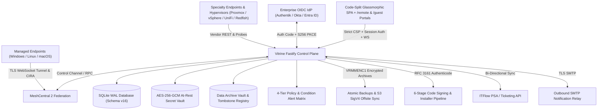

# Vitrine RMM

<p align="center">
  
</p>

<p align="center">
  <strong>Modern, glassmorphic self-hosted RMM powered by MeshCentral 2 — engineered for NinjaRMM feature parity and beyond.</strong><br/>
  Zero-trust fleet orchestration with OpenID Connect (PKCE) SSO, silent background tools, 4-tier cascading policy & alert governance, Data Archive Vault offboarding, live hypervisor & vendor-native specialty appliance APIs, AES-256-GCM encrypted backups, and low-latency remote control.
</p>

<p align="center">
  <a href="https://github.com/TylerHats/Vitrine-RMM/releases/latest"></a>
  <a href="https://github.com/TylerHats/Vitrine-RMM/wiki"></a>
  <a href="https://hub.docker.com/r/tylerhats/vitrine-rmm"></a>
  <a href="LICENSE"></a>
</p>

---

## 📖 Detailed Documentation (GitHub Wiki)

All deep architectural guides, API references, security specifications, and setup walkthroughs are maintained in the [**GitHub Wiki**](https://github.com/TylerHats/Vitrine-RMM/wiki):

*   [**Installation & Setup**](https://github.com/TylerHats/Vitrine-RMM/wiki/Installation-and-Setup) — System requirements (Node.js 20+), bare-metal `systemd` setup (safe alongside existing `/opt/meshcentral`), multi-arch (`linux/amd64` & `linux/arm64`) Docker Compose deployment, First-Run Super Admin bootstrap, and Reverse Proxy / Let's Encrypt TLS OOBE Wizard.
*   [**Architecture & Security**](https://github.com/TylerHats/Vitrine-RMM/wiki/Architecture-and-Security) — Scrypt & OpenID Connect (`S256 PKCE`) SSO authentication, `HttpOnly` sessions with live WebSocket revocation, strict multi-tenant RBAC (`super_admin`, `technician`, `client_admin`), AES-256-GCM vault (including encrypted `secret` custom attributes), per-user RFC 6238 Step-Up TOTP MFA, strict `Content-Security-Policy` (`CSP`), DNS-rebinding SSRF defense, and Scoped Vendor Guest Portal.
*   [**Offboarding & Data Archive Vault**](https://github.com/TylerHats/Vitrine-RMM/wiki/Offboarding-and-Archive-Vault) — Clean endpoint & client offboarding, offline queue & auto-archive rules, preserved BitLocker/LAPS Data Archive Vault, automatic resurrection on wake/reinstall, and deleted-client tombstones for quiet self-offboarding.
*   [**Hierarchical Policy & Condition Alerting Engine**](https://github.com/TylerHats/Vitrine-RMM/wiki/Hierarchical-Policy-Engine) — 4-tier cascading governance (`Global -> Client -> Site -> Role`), customizable LAPS local admin username & offline rotation deferral, and per-tier multi-channel state notifications (tenant-scoped Web UI, SMTP Email, Direct PSA Ticket).
*   [**MeshCentral 2 Federation & QuickSupport Portal**](https://github.com/TylerHats/Vitrine-RMM/wiki/MeshCentral-Engine-Integration) — Multi-instance MeshCentral 2 federation, customer-facing QuickSupport portal (`/remote`), 6-stage Authenticode signing pipeline, zero-touch Intel AMT/vPro CIRA, and 5-tier peer-relayed Wake-on-LAN.
*   [**Specialty Endpoints, Vendor APIs & Hypervisor Orchestration**](https://github.com/TylerHats/Vitrine-RMM/wiki/Network-Discovery-and-Topology) — Live hypervisor polling & VM power/snapshot actions for **Proxmox VE**, **VMware vSphere/ESXi**, and **Hyper-V**, plus vendor-native polling for Ubiquiti UniFi OS, DMTF Redfish (iDRAC/iLO/BMC), FortiOS, Synology DSM, APC NMC3, VoIP PBXs, Printers, and generic SNMP/TCP/TLS probes.
*   [**Backups, Self-Updater & Disaster Recovery**](https://github.com/TylerHats/Vitrine-RMM/wiki/Backups-Updates-and-Maintenance) — Unified AES-256-GCM encrypted `.vrmm-backup.gz` (`VRMMENC1`) archives, MFA-gated **Backup Recovery Key Reveal & Escrow**, reboot-resilient scheduled snapshots, AWS SigV4 S3/R2/MinIO/B2 offsite sync, cross-machine live vault reload, and full bare-metal Git + build + auto-rollback self-updater.
*   [**Silent Background Management Suite**](https://github.com/TylerHats/Vitrine-RMM/wiki/Background-Management-Suite) — Background PowerShell/Bash PTY shells, Process & Services manager, Remote Registry/Config editor, Dual-Pane File Manager, Event Logs, and Task Scheduler.
*   [**Patch Management & Deployments**](https://github.com/TylerHats/Vitrine-RMM/wiki/Patch-Management-and-Deployments) — OS & 3rd-party patching, NVD CVE/CVSS v3.1 scoring, OEM driver catalogs, and KB rollback.
*   [**Self-Healing & Script Orchestration**](https://github.com/TylerHats/Vitrine-RMM/wiki/Self-Healing-and-Automations) — Condition watchdogs with circuit-breaker flap protection, RBAC script library, and `$vitrine.*` runtime token injection.
*   [**Two-Way PSA & REST API**](https://github.com/TylerHats/Vitrine-RMM/wiki/Two-Way-PSA-and-REST-API) — Bidirectional ITFlow ticketing, HMAC-SHA256 authenticated webhooks, full `v2.5.1` REST/WebSocket API reference, and Executive QBR reporting.

---

## 🛠️ High-Level System Architecture



---

## ⚡ Quick Start

### 1. Requirements
*   **Operating System**: Linux (`x86_64` / `amd64` or `aarch64` / `arm64`, Debian 12+ or Ubuntu 22.04/24.04 LTS recommended) or any Docker host.
*   **Runtime**: Node.js **20+** & npm (for bare-metal); Docker 24+ & Docker Compose v2+ (for containerized deployments).
*   **Existing MeshCentral Safety**: `install.sh`, `uninstall.sh`, and the runtime engine strictly isolate all Vitrine files to the repository directory (`./data`, `./branding`, `./dev-meshcentral`) and **never** modify or write to an existing `/opt/meshcentral` installation.

### 2. Multi-Arch Docker Compose Deployment (Recommended — `amd64` & `arm64`)
```bash
git clone https://github.com/TylerHats/Vitrine-RMM.git
cd Vitrine-RMM
docker compose up -d
```
Or pull the official multi-architecture (`linux/amd64` & `linux/arm64`) image directly from Docker Hub (`tylerhats/vitrine-rmm:2.5.1` / `tylerhats/vitrine-rmm:latest`). See [`DOCKER_README.md`](DOCKER_README.md) for full volume and environment details.

### 3. Automated Bare-Metal Installation (`systemd`)
```bash
git clone https://github.com/TylerHats/Vitrine-RMM.git
cd Vitrine-RMM
./install.sh
```
`install.sh` verifies Node.js 20+, builds production frontend & backend bundles, locks down `./data` permissions (`chmod 700`), and optionally installs/restarts `vitrine-rmm.service` (with `VITRINE_ENABLE_GIT_SELF_PULL=true` enabled for one-click web UI updates).

### 4. First-Run Bootstrap & OOBE Wizard
Open `http://localhost:8080/` in your browser:
1. **Create Your Initial MSP Super Admin**: On a fresh database, Vitrine starts completely clean (zero demo records or hardcoded accounts) and presents the **Initial Super Admin Bootstrap** screen, enrolling your per-user RFC 6238 TOTP authenticator secret and generating **8 single-use emergency recovery codes**.
2. **Guided Setup Wizard**: Configure white-label branding, Reverse Proxy & TLS domain (`Nginx`, `Caddy`, `Traefik`, or `Cloudflare Tunnel`), MeshCentral 2 connection, Enterprise OIDC SSO, SMTP/PSA integrations, and **Backup Encryption Key Escrow**.

---

## 🛡️ Comprehensive Feature Matrix (v2.5.1 Stable)

1. **Zero-Trust Auth, Enterprise OIDC PKCE SSO, Strict RBAC & AES-256-GCM Vault**:
   * **Scrypt Local Auth + OpenID Connect (`S256 PKCE`) SSO**: Memory-hard scrypt (`N=16384`) local authentication alongside full Authorization Code + `S256 PKCE` SSO (`Authentik`, `Keycloak`, `Pocket ID`, `Okta`, `Entra ID`) with live discovery testing, cryptographic `state`/`nonce` validation, and optional JIT technician provisioning.
   * **Strict Multi-Tenant RBAC & WebSocket Live Revocation**: Server-side tenant isolation across `super_admin`, `technician`, and `client_admin` roles (including tenant-isolated notifications and sub-route lockdown), `Origin` validation on `/ws/*` upgrades, and live session token verification on every WebSocket frame/tick.
   * **AES-256-GCM Secret Vault & Per-User Step-Up TOTP MFA**: Encrypts LAPS passwords, BitLocker/LUKS/FileVault recovery keys, **`secret`-type Custom Attributes**, MeshCentral tokens, hypervisor/specialty API keys, and backup keys at rest (`enc:v1:...`). Revealing LAPS, BitLocker, `secret` custom fields, Backup Recovery Keys, or Break-Glass exports requires per-user RFC 6238 TOTP Step-Up MFA with anti-replay protection and single-use recovery codes.
   * **Strict `Content-Security-Policy` & DNS-Rebinding SSRF Protection**: Enforces strict `CSP` (`script-src 'self'; object-src 'none'`) and pre-connection DNS resolution validation (`validateOutboundHostSafety`) blocking loopback, RFC1918, link-local (`169.254.169.254`), and IPv6 ULA/mapped rebinding targets across all outbound probes and integrations.
2. **Customizable LAPS Local Admin & Offline Rotation Deferral**:
   * Customize the managed local administrator username (`laps_account_name`, e.g. `ClientITAdmin`) across Global, Client, Site, and Role policy tiers, plus generate offline **Break-Glass LAPS Exports** (MFA-gated).
   * **Offline Lockout Protection**: Scheduled LAPS rotations automatically **defer** (`rotation_pending_online = 1`) whenever an endpoint is offline — and **skip** if offboarding is pending — ensuring Vitrine never overwrites its vaulted password before the endpoint confirms local OS password rotation.
3. **Clean Endpoint & Client Offboarding + Data Archive Vault**:
   * **Online Clean Offboard & Offline Queueing**: Reverts policies, handles the managed local admin account per 3 contextual policy rules (`Explicit Device Offboard`, `Client Archived`, `Client Deleted`), and cleanly removes agent software on online endpoints while queueing offline endpoints (with force-archive and auto-archive-after-X-days options).
   * **Data Archive Vault & Tombstone Registry**: Preserves offboarded endpoints and archived clients in their last-known state while automatically resurrecting waking endpoints under active clients and quietly self-offboarding endpoints belonging to permanently deleted clients.
4. **4-Tier Cascading Policy & Condition Notification Matrix**:
   * Configure threshold-based fleet condition rules across Global, Client, Site, and Role tiers with independent per-channel routing (**Tenant-Scoped Web UI Bell**, **SMTP Email**, and **Direct PSA Ticket Creation**) and deduplication cooldowns.
5. **Live Hypervisor Orchestration, Specialty Vendor APIs & Interactive Setup Guides**:
   * **Live Hypervisor Cluster Sync & VM Actions**: Polls **Proxmox VE** (`/api2/json/cluster/resources` & `PVEAPIToken`), **VMware vSphere/ESXi** (`/api/vcenter/vm`), and **Microsoft Hyper-V** (via agentless WinRM/MeshCentral bridge) with live VM `start`, `stop`, `reboot`, and `snapshot` dispatch.
   * **Vendor-Native Specialty Endpoints**: Native polling for **Ubiquiti UniFi OS**, **DMTF Redfish** (`iDRAC 9`, `iLO 5/6`, `Supermicro BMC`), **FortiOS**, **Synology DSM**, **APC Smart-UPS NMC3**, **VoIP PBXs**, **Printers/MFPs**, and **WAN SSL/TLS Expirations** with a step-by-step **Vendor Setup Walkthrough Modal**.
6. **Multi-Instance MeshCentral Federation, QuickSupport (`/remote`) & Authenticode Pipeline**:
   * Federate multiple isolated MeshCentral 2 instances, host a toggleable branded **QuickSupport Portal (`/remote`)**, and sign agent installers via a 6-stage Authenticode / Cloud HSM pipeline.
7. **Code-Split Glassmorphic SPA, Interactive KVM & Silent Background Tools**:
   * Fast route-level lazy-loaded SPA (`~25 kB` gzipped core entry), WebRTC KVM, Headless Ghost sessions, Intel AMT/vPro KVM, background SYSTEM/User PTY shells, Process/Service/Registry/File/Event/Task managers, CVE patch orchestration, and 5-tier subnet-peer Wake-on-LAN.
8. **Unified Encrypted Self-Backups (`VRMMENC1`), Key Escrow & Full Git Self-Updater**:
   * Reboot-resilient scheduled hot SQLite snapshots bundled with `.vault-key.json` and branding into AES-256-GCM `.vrmm-backup.gz` archives, Step-Up MFA **Backup Recovery Key Reveal/Export & Escrow Reminders**, cross-machine live vault key reload (`reloadVaultMasterKey()`), S3 SigV4 offsite sync, and full bare-metal Git fetch + build + automatic rollback self-updates.

---

## 🧹 Clean Uninstallation

To stop background services, remove build artifacts, and optionally purge local Vitrine data vaults (leaving any neighboring `/opt/meshcentral` untouched):
```bash
./uninstall.sh
```

---

## 📄 License

Vitrine RMM is open source licensed under the **GNU General Public License v3.0 (GPL-3.0)**. See [LICENSE](LICENSE) for details.
