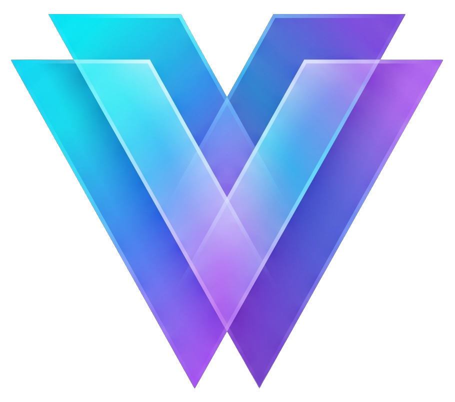
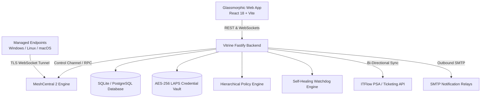

# Vitrine RMM

<p align="center">
  
</p>

<p align="center">
  <strong>Modern, glassmorphic self-hosted RMM powered by MeshCentral 2.</strong><br/>
  Complete fleet orchestration with silent background tools, hierarchical policy automation, patch management, and low-latency remote control.
</p>

<p align="center">
  <a href="https://github.com/TylerHats/Vitrine-RMM/wiki"></a>
  <a href="https://hub.docker.com/r/tylerhats/vitrine-rmm"></a>
  <a href="LICENSE"></a>
</p>

---

## 📖 Detailed Documentation (GitHub Wiki)

All deep architectural guides, API endpoints, agent compilation steps, and configuration tutorials are available in the [**GitHub Wiki**](https://github.com/TylerHats/Vitrine-RMM/wiki):

*   [**Installation & Setup**](https://github.com/TylerHats/Vitrine-RMM/wiki/Installation-and-Setup) — Detailed system requirements, automated bare-metal systemd installation, Docker Compose deployments, and First-Run onboarding.
*   [**Architecture & Security**](https://github.com/TylerHats/Vitrine-RMM/wiki/Architecture-and-Security) — Multi-tenant isolation, OpenID Connect / Authentik SSO integration, AES-256-GCM LAPS credential vault, and cyber isolation firewalling.
*   [**MeshCentral 2 Engine Integration**](https://github.com/TylerHats/Vitrine-RMM/wiki/MeshCentral-Engine-Integration) — WebSockets & WebRTC relay bridge, Intel AMT / vPro out-of-band hardware control, and low-latency KVM display pipelines.
*   [**Hierarchical Policy Inheritance Engine**](https://github.com/TylerHats/Vitrine-RMM/wiki/Hierarchical-Policy-Engine) — Multi-tiered rules engine ($\text{Global} \rightarrow \text{Client} \rightarrow \text{Site} \rightarrow \text{Device Role}$) with real-time inheritance conflict resolution.
*   [**Silent Background Management Suite**](https://github.com/TylerHats/Vitrine-RMM/wiki/Background-Management-Suite) — Interactive background PowerShell/Bash shells, live Task Manager, Windows Services controller, Remote Registry browser, and Dual-Pane File Manager.
*   [**Patch Management & Deployments**](https://github.com/TylerHats/Vitrine-RMM/wiki/Patch-Management-and-Deployments) — Windows Update staging, OEM firmware drivers, Winget/Chocolatey third-party silent installers, and reboot orchestration.
*   [**Self-Healing & Script Orchestration**](https://github.com/TylerHats/Vitrine-RMM/wiki/Self-Healing-and-Automations) — Condition-based watchdogs (hung services, low disk, high CPU) with automated auto-remediation scripts and mass orchestration.
*   [**Network Discovery & Topology**](https://github.com/TylerHats/Vitrine-RMM/wiki/Network-Discovery-and-Topology) — Managed agent SNMP probes, subnet ARP/IP sweeps, LLDP/CDP Layer-2 switch port mapping, and hypervisor virtualization monitoring (Proxmox VE / Hyper-V).
*   [**Two-Way PSA & REST API**](https://github.com/TylerHats/Vitrine-RMM/wiki/Two-Way-PSA-and-REST-API) — Bidirectional ticketing synchronization with ITFlow, webhook event bus, and Executive QBR PDF reporting.

---

## 🛠️ High-Level System Architecture



---

## ⚡ Quick Start

### 1. Requirements
*   **Operating System**: Linux (Debian 12+ or Ubuntu 22.04+ recommended).
*   **Runtime**: Node.js 18 or higher & npm.
*   **Docker** (Optional for container deployments).

### 2. Automated Bootstrap Installation (Bare-Metal Service)
```bash
git clone https://github.com/TylerHats/Vitrine-RMM.git
cd Vitrine-RMM
./install.sh
```

The installer verifies prerequisites, compiles the production frontend and backend bundles, creates an immutable SQLite database, and optionally installs and starts a `vitrine-rmm.service` systemd background daemon.

To start manually:
```bash
PORT=8080 node backend/dist/server.js
```

### 3. Docker Compose Deployment
```bash
docker compose up -d
```

Open `http://localhost:8080/` in your browser to launch the platform and begin onboarding with the built-in Setup Wizard.

---

## 🛡️ Key Features Overview

1. **Modern Glassmorphic Web UI**: Native dark/light modes with automatic OS-matching, dynamic backdrop blur tokens, specular edge highlights, and fluid micro-animations.
2. **SSO, Granular RBAC & Multi-Tenancy**: Authentik / OpenID Connect SSO, tenant isolation, and strict permission matrices.
3. **Interactive Screen Control**: Full-screen low-latency remote desktop, multi-monitor switching, remote audio pass-through, and clipboard synchronization powered by MeshCentral.
4. **"Ghost Session"**: Secondary graphical admin session (via headless RDP / virtual display driver) allowing GUI administration without disturbing the end-user's physical screen.
5. **Remote Connection Privacy & Consent Controls**: End-user consent prompts with configurable acceptance countdowns and auto-lock on technician disconnection.
6. **Silent Background Process & Services Manager**: Live task manager inspecting process trees and resource consumption, alongside a Windows Services manager to start, stop, and restart services without screen sharing.
7. **Remote Registry Browser & Editor**: Live registry hive viewer and value modifier operating completely in the background.
8. **Interactive Background Shells**: WebSockets-driven interactive PowerShell, CMD, and Bash consoles with command history and snippet execution.
9. **Dual-Pane Remote File Manager**: Background filesystem browser with chunked uploads/downloads, directory traversal, and remote execution.
10. **Telemetry & Hardware Lifecycle Auditing**: Real-time and historical CPU/RAM/disk metrics, SMART status, BitLocker key extraction, TPM version, and BIOS serials.
11. **OS & Driver Patch Management**: Automated scan, staging, and installation schedules for Windows updates and OEM drivers.
12. **Third-Party Application Patching**: Winget and Chocolatey package management for silent deployments and version updates.
13. **Condition Monitoring & Auto-Remediation (Self-Healing)**: Event-driven watchers that auto-execute remediation scripts before escalating alerts.
14. **Centralized Scripting Library & Mass Orchestration**: Version-controlled PowerShell, Batch, Bash, and Python repository with multi-target execution.
15. **Endpoint Network Quarantine (Cyber Isolation)**: One-click incident response isolation injecting firewall rules dropping all traffic while preserving the RMM WebSocket tunnel.
16. **Automated LAPS Engine**: Automatic rotation of unique local administrator passwords with an encrypted vault and timed-reveal permissions.
17. **Two-Way PSA / ITFlow Synchronization**: Bidirectional ticket synchronization opening tickets on threshold alerts and auto-closing upon self-healing.
18. **Executive QBR & Health Report Generator**: Automated generation of branded client-facing PDF health summaries and Quarterly Business Reviews.

---

## 🧹 Clean Uninstallation

To cleanly stop background services, remove build caches, and optionally purge data vaults, run:
```bash
./uninstall.sh
```

---

## 📄 License

Vitrine RMM is open source licensed under the **GNU General Public License v3.0 (GPL-3.0)**. See [LICENSE](LICENSE) for details.
