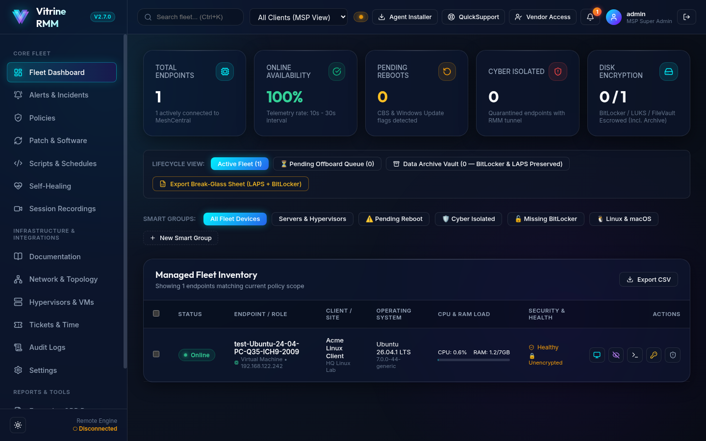
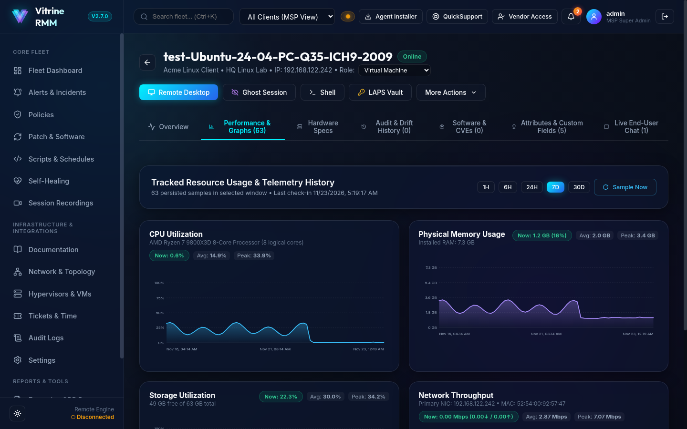
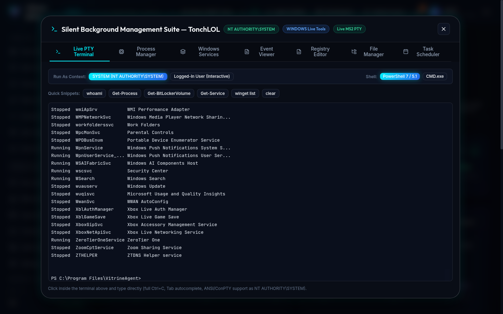
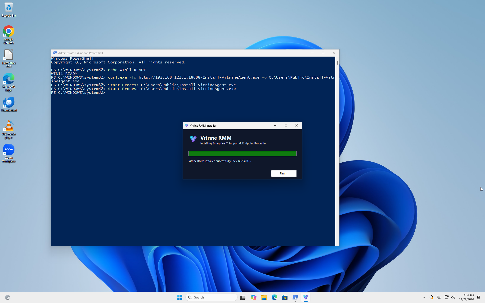
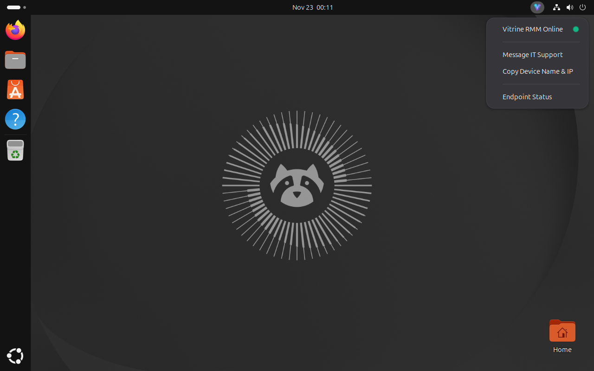
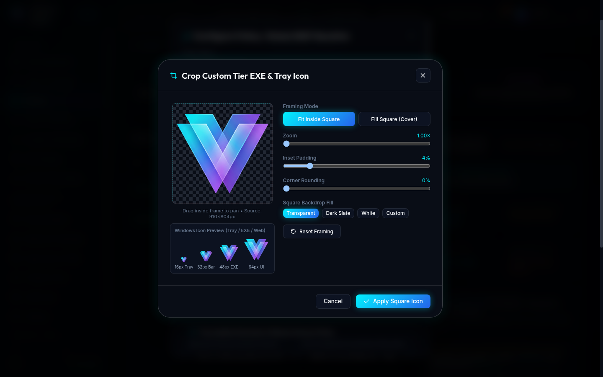
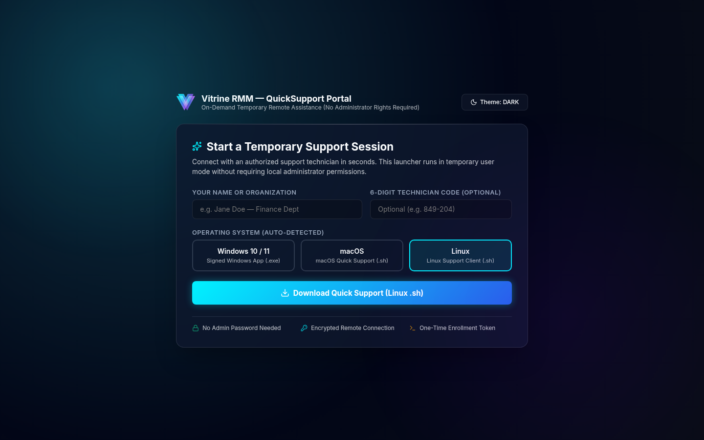
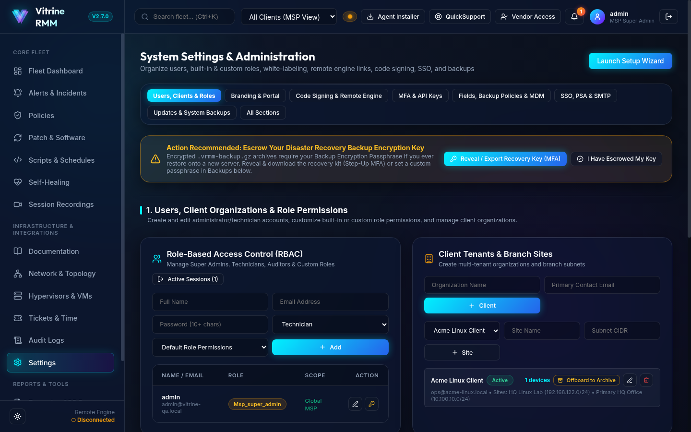
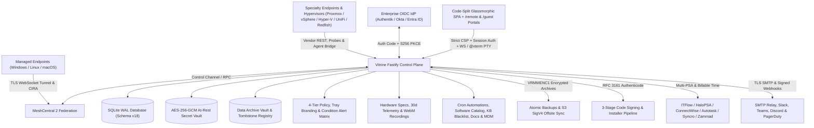

# Vitrine RMM

<p align="center">
  
</p>

<p align="center">
  <strong>Modern, glassmorphic self-hosted RMM powered by MeshCentral 2 — engineered for NinjaRMM feature parity and beyond.</strong><br/>
  Zero-trust fleet orchestration with OpenID Connect (PKCE) SSO, 20-permission RBAC &amp; scoped API keys, silent background tools, 4-tier cascading policy &amp; alert governance, Data Archive Vault offboarding, live hypervisor &amp; vendor-native specialty appliance APIs, AES-256-GCM encrypted backups, and low-latency remote control.
</p>

<p align="center">
  <a href="https://github.com/TylerHats/Vitrine-RMM/releases/latest"></a>
  <a href="https://github.com/TylerHats/Vitrine-RMM/wiki"></a>
  <a href="https://hub.docker.com/r/tylerhats/vitrine-rmm"></a>
  <a href="LICENSE"></a>
</p>

---

## 📸 Product Tour

<p align="center">
  
</p>

| Endpoint Hardware &amp; Telemetry (`7D` View) | Silent Background Tools &amp; Live ConPTY |
| :---: | :---: |
|  |  |

| Native Windows EV-Signed GUI Installer | Cross-Distro Linux Theme-Aware Tray &amp; Dialogs |
| :---: | :---: |
|  |  |

| Per-Policy &amp; Tray Square Icon Cropper | QuickSupport Client Portal (`/remote`) |
| :---: | :---: |
|  |  |

<p align="center">
  <strong>Focused Settings &amp; Multi-Tenant Administration</strong><br/>
  
</p>

---

## 📖 Detailed Documentation (GitHub Wiki)

All deep architectural guides, API references, security specifications, and setup walkthroughs are maintained in the [**GitHub Wiki**](https://github.com/TylerHats/Vitrine-RMM/wiki):

*   [**Installation & Setup**](https://github.com/TylerHats/Vitrine-RMM/wiki/Installation-and-Setup) — System requirements (Node.js 20+), bare-metal `systemd` setup (safe alongside existing MeshCentral 2 installations), multi-arch (`linux/amd64` & `linux/arm64`) Docker Compose deployment (including optional `--profile full-stack`), mandatory First-Run Super Admin TOTP verification, and Reverse Proxy setup validation (`Nginx`, `Caddy`, `Traefik`, or `Cloudflare Tunnel` with `VITRINE_TRUST_PROXY=true`).
*   [**Architecture & Security**](https://github.com/TylerHats/Vitrine-RMM/wiki/Architecture-and-Security) — Scrypt & OpenID Connect (`S256 PKCE`) SSO authentication, `HttpOnly` sessions with live WebSocket revocation, 4-tier RBAC (`msp_super_admin`, `technician`, `client_admin`, `auditor`) with an Editable Built-In + Custom 20-permission Role Matrix, Scoped REST API Keys (`vrmm_live_...`), AES-256-GCM vault (including encrypted `secret` custom attributes & runbook vault secrets), per-user RFC 6238 Step-Up TOTP MFA, strict `Content-Security-Policy` (`CSP`), DNS-pinned SSRF defense, Searchable Audit Explorer (`CSV`/`JSON` export), and Scoped Vendor Guest Portal.
*   [**Offboarding & Data Archive Vault**](https://github.com/TylerHats/Vitrine-RMM/wiki/Offboarding-and-Archive-Vault) — Clean endpoint & client offboarding, offline queue & auto-archive rules, preserved BitLocker/LAPS Data Archive Vault, automatic resurrection on wake/reinstall, and deleted-client tombstones for quiet self-offboarding.
*   [**Hierarchical Policy & Condition Alerting Engine**](https://github.com/TylerHats/Vitrine-RMM/wiki/Hierarchical-Policy-Engine) — 4-tier cascading governance (`Global -> Client -> Site -> Role`), 4-tier Agent Tray Branding, System Light/Dark auto-theme (`tray_theme`) & Popup Menu customization across Windows & Linux, cross-platform Device Role auto-detection + manual lock, customizable LAPS local admin username & offline rotation deferral, Endpoint Backup Policies & MDM Compliance Profiles, and stateful Alert Incidents across Web UI, SMTP Email, Multi-Channel Webhooks (Slack, MS Teams, Discord, PagerDuty, HMAC Webhooks), and Direct PSA Tickets.
*   [**MeshCentral 2 Federation & QuickSupport Portal**](https://github.com/TylerHats/Vitrine-RMM/wiki/MeshCentral-Engine-Integration) — Multi-instance MeshCentral 2 federation, 3-option token onboarding, customer-facing QuickSupport portal (`/remote`), 3-stage Authenticode & RFC 3161 signing pipeline, cross-distro Linux companion & GTK3/DBus-SNI theme-aware tray parity (`Debian/Ubuntu`, `RHEL/Fedora/Rocky/Alma`, `Arch/Manjaro`), zero-touch Intel AMT/vPro CIRA, and 5-tier peer-relayed Wake-on-LAN.
*   [**Specialty Endpoints, Vendor APIs & Hypervisor Orchestration**](https://github.com/TylerHats/Vitrine-RMM/wiki/Network-Discovery-and-Topology) — Live hypervisor polling & VM power/snapshot actions for **Proxmox VE** (`/api2/json/nodes`, `/qemu` & `/lxc`, `PVEAPIToken`), **VMware vSphere/ESXi** REST (`/api/vcenter/vm`), and **Microsoft Hyper-V** (via linked Windows MeshCentral agent PowerShell bridge), plus vendor-native polling for Ubiquiti UniFi OS, DMTF Redfish (iDRAC/iLO/BMC), FortiOS, Synology DSM, APC NMC3, VoIP PBXs, Printers, and generic SNMP/TCP/TLS probes.
*   [**Backups, Self-Updater & Disaster Recovery**](https://github.com/TylerHats/Vitrine-RMM/wiki/Backups-Updates-and-Maintenance) — Unified AES-256-GCM encrypted `.vrmm-backup.gz` (`VRMMENC1`) archives, MFA-gated **Backup Recovery Key Reveal & Escrow**, reboot-resilient scheduled snapshots, AWS SigV4 S3/R2/MinIO/B2 offsite sync, cross-machine live vault reload, and full bare-metal Git + build + auto-rollback self-updater.
*   [**Silent Background Management Suite**](https://github.com/TylerHats/Vitrine-RMM/wiki/Background-Management-Suite) — Live `@xterm/xterm` interactive PowerShell/Bash/Zsh PTY shells, Process & Services manager, Remote Registry/Config editor, Dual-Pane File Manager, Event Logs, Task Scheduler, Session Recordings Archive (inline WebM playback), and Deep Hardware Specs & Historical Performance Telemetry Charts (`1h`/`6h`/`24h`/`7d`/`30d`).
*   [**Patch Management & Deployments**](https://github.com/TylerHats/Vitrine-RMM/wiki/Patch-Management-and-Deployments) — OS & 3rd-party patching, NVD CVE/CVSS v3.1 scoring, Software Package Catalog (`winget`, `choco`, `apt`, `dnf`, `brew`, MSI/DEB upload), KB & Package Blacklist, OEM driver catalogs, and KB rollback.
*   [**Self-Healing & Script Orchestration**](https://github.com/TylerHats/Vitrine-RMM/wiki/Self-Healing-and-Automations) — Condition watchdogs with circuit-breaker flap protection, Scheduled Cron Automations, MSP Documentation/SOPs/Runbooks with linked script execution, RBAC script library, and typed **`VITRINE_PARAM_<NAME>`** environment variables (zero code interpolation).
*   [**Two-Way PSA & REST API**](https://github.com/TylerHats/Vitrine-RMM/wiki/Two-Way-PSA-and-REST-API) — Multi-PSA connectors & billable time entries (**ITFlow**, **HaloPSA**, **ConnectWise**, **Autotask**, **Syncro**, **Zammad**), HMAC-SHA256 authenticated webhooks, scoped `vrmm_live_...` REST API reference, and Executive QBR reporting.

---

## 🛠️ High-Level System Architecture



---

## ⚡ Quick Start

### 1. Requirements
*   **Operating System**: Linux (`x86_64` / `amd64` or `aarch64` / `arm64`, Debian 12+ or Ubuntu 22.04/24.04 LTS recommended) or any Docker host.
*   **Runtime**: Node.js **20+** & npm (for bare-metal); Docker 24+ & Docker Compose v2+ (for containerized deployments).
*   **Existing MeshCentral Safety & Read-Only Detection**: `install.sh`, `uninstall.sh`, and the runtime engine strictly isolate all Vitrine files to the repository directory (`./data`, `./branding`, optional `./dev-meshcentral`) and **never** alter an existing MeshCentral installation automatically. Vitrine scans **read-only** across systemd units, `/proc`, `/opt/meshcentral`, `/var/lib/meshcentral`, `/srv/meshcentral`, `/usr/local/meshcentral`, `/root`, and `/home/*` to detect co-located MeshCentral instances and only offers an explicit, Step-Up MFA-gated `config.json` backup-and-patch helper (`allowFraming` / `disableAgentUpdate`, creating a timestamped `.vitrine-bak-*` backup) inside Initial Setup.

### 2. Multi-Arch Docker Compose Deployment (Recommended — `amd64` & `arm64`)
```bash
git clone https://github.com/TylerHats/Vitrine-RMM.git
cd Vitrine-RMM
docker compose up -d
```
To deploy Vitrine alongside an optional co-packaged, isolated MeshCentral 2 container (`vitrine-meshcentral`), launch the `full-stack` profile:
```bash
docker compose --profile full-stack up -d
```
Or pull the official multi-architecture (`linux/amd64` & `linux/arm64`) image directly from Docker Hub (`tylerhats/vitrine-rmm:2.7.0` / `tylerhats/vitrine-rmm:latest`). See [`DOCKER_README.md`](DOCKER_README.md) for full volume, `--profile full-stack`, and environment variable details.

### 3. Automated Bare-Metal Installation (`systemd`)
```bash
git clone https://github.com/TylerHats/Vitrine-RMM.git
cd Vitrine-RMM
./install.sh
```
`install.sh` enforces **Node.js 20+** and `npm`, validates/installs the **Clang + LLD + MinGW-w64** toolchain for native Windows UCRT PE builds, runs deterministic `npm ci` builds for `frontend/` and `backend/`, locks down `./data` (including `signed-agents/` and `signing-staging/`) with `chmod 700`, preserves active ports and `.env` overrides across upgrades, and optionally installs/restarts `vitrine-rmm.service` (which supports one-click bare-metal self-updates under systemd; opt out via `VITRINE_DISABLE_GIT_SELF_PULL=true`).

### 4. First-Run Bootstrap & OOBE Wizard
Open `http://localhost:8080/` in your browser:
1. **Create Your Initial MSP Super Admin & Verify TOTP**: On a fresh database, Vitrine starts completely clean (zero demo records or hardcoded accounts) and presents the **Initial Super Admin Bootstrap** screen, enrolling your per-user RFC 6238 TOTP authenticator secret and generating **8 single-use emergency recovery codes**. You must verify your 6-digit authenticator code before entering the Setup Wizard, and subsequent logins enforce the TOTP / recovery-code MFA challenge.
2. **Guided Setup Wizard**:
   * **White-Label Branding, Square Icon Cropper & QuickSupport Profile**: Crop/upload your custom square icon via the interactive **Icon Cropper Modal** (`IconCropModal`), configure adaptive Light/Dark/System themes, and customize dedicated **QuickSupport On-Demand (`/remote`)** branding & icons.
   * **3-Option MeshCentral 2 Token Onboarding**: Connect via (A) the **MeshCentral Web UI** Login Tokens guide, (B) **in-app WebSocket Login Token auto-generation** (supporting 2FA/TOTP without storing your admin password), or (C) the **`meshctrl.js` CLI**.
   * **Reverse Proxy & TLS Validation**: Vitrine binds local HTTP behind a reverse proxy (`Nginx`, `Caddy`, `Traefik`, or `Cloudflare Tunnel`) with `VITRINE_TRUST_PROXY=true` and validates forwarded headers and public domain TLS reachability in the wizard.
   * **Code Signing, SMTP, Enterprise OIDC SSO & Backup Encryption Key Escrow**: Configure local/cloud Authenticode EV signing, outbound SMTP, OIDC SSO, and acknowledge/escrow your backup recovery passphrase.

---

## 🛡️ Comprehensive Feature Matrix (v2.7.0 Stable)

1. **Zero-Trust Auth, Enterprise OIDC PKCE SSO, 20-Permission RBAC & AES-256-GCM Vault**:
   * **Scrypt Local Auth + OpenID Connect (`S256 PKCE`) SSO**: Memory-hard scrypt (`N=16384`) local authentication alongside full Authorization Code + `S256 PKCE` SSO (`Authentik`, `Keycloak`, `Pocket ID`, `Okta`, `Entra ID`) with live discovery testing, cookie-bound & server-verified cryptographic `state` + `PKCE` + `nonce` + asymmetric JWKS signature checks, immutable `(issuer, sub)` identity binding, verified-email linking (`email_verified=true`) to pre-registered Vitrine RBAC users (no unapproved JIT provisioning), and a one-click **`"Sign in with SSO"`** button on the login screen.
   * **4-Tier RBAC, Custom Role Matrix & Scoped REST API Keys**: Enforces server-side tenant isolation across 4 base tiers (**`msp_super_admin`** — with `super_admin`/`admin` aliases, **`technician`**, **`client_admin`**, and **`auditor`**), an **Editable Built-In + Custom 20-Permission RBAC Role Matrix**, **Scoped REST API Keys (`vrmm_live_...`)**, `Origin` validation on `/ws/*` upgrades, and live session token verification on every WebSocket frame/tick.
   * **Mandatory Login MFA, Step-Up TOTP & AES-256-GCM Secret Vault**: Encrypts LAPS passwords, BitLocker/LUKS/FileVault recovery keys, **`secret`-type Custom Attributes**, **Documentation/Runbook vault secrets**, MeshCentral tokens, hypervisor/specialty/PSA API keys, webhook secrets, and backup passphrases at rest (`enc:v1:...`). Enforces initial Super Admin TOTP verification before setup, TOTP / single-use recovery-code MFA challenge on login, and per-user RFC 6238 Step-Up TOTP MFA with anti-replay protection for revealing sensitive secrets.
   * **Strict `Content-Security-Policy` & DNS-Pinned SSRF Protection**: Enforces strict `CSP` (`script-src 'self'; object-src 'none'`) and DNS-pinned, non-redirecting outbound fetches (`safeOutboundFetch` & `validateOutboundHostSafety`) that block cloud metadata (`169.254.169.254`, `metadata.google.internal`, `100.100.100.200`, `fd00:ec2::254`), link-local, CGNAT (`100.64.0.0/10`), and redirect abuse everywhere, block private/loopback IPs on public/webhook endpoints, and permit controlled LAN/loopback targets for self-hosted integrations (MeshCentral, Hypervisors, Appliances, Local Signing API, SMTP/S3, and optional private OIDC via `VITRINE_ALLOW_PRIVATE_OIDC=true`).
   * **Searchable Audit Explorer**: Immutable technician, LAPS, BitLocker, RBAC, and automation event trail in **`AuditExplorerView`** with filterable search and one-click **CSV / JSON export**.
2. **Customizable LAPS Local Admin & Offline Rotation Deferral**:
   * Customize the managed local administrator username (`laps_account_name`, e.g. `ClientITAdmin`) across Global, Client, Site, and Role policy tiers, plus generate offline **Break-Glass LAPS Exports** (MFA-gated).
   * **Offline Lockout Protection**: Scheduled LAPS rotations automatically **defer** (`rotation_pending_online = 1`) whenever an endpoint is offline — and **skip** if offboarding is pending — ensuring Vitrine never overwrites its vaulted password before the endpoint confirms local OS password rotation.
3. **Clean Endpoint & Client Offboarding + Data Archive Vault**:
   * **Online Clean Offboard & Offline Queueing**: Reverts policies, handles the managed local admin account per 3 contextual policy rules (`Explicit Device Offboard`, `Client Archived`, `Client Deleted`), and cleanly removes agent software on online endpoints while queueing offline endpoints (with force-archive and auto-archive-after-X-days options).
   * **Data Archive Vault & Tombstone Registry**: Preserves offboarded endpoints and archived clients in their last-known state while automatically resurrecting waking endpoints under active clients and quietly self-offboarding endpoints belonging to permanently deleted clients.
4. **4-Tier Cascading Policy, Cross-Platform Tray Branding, Role Lock & Stateful Alert Incidents**:
   * **4-Tier Policy, Adaptive Tray Theme & Customization**: Cascade settings across `Global -> Client -> Site -> Role`, including **4-Tier Agent Tray Branding & Popup Menu Customization** (`tray_brand_name`, custom tray icon, `tray_theme` automatic System Light/Dark tracking or explicit `light`/`dark` override across Windows & Linux, support contact links, and custom menu actions), **Cross-Platform Device Role Auto-Detection & Manual Lock** (`Workstation`, `Laptop`, `Server`, `Virtual Machine`), **Endpoint Backup Policies**, and **MDM Compliance Profiles**.
   * **Stateful Alert Incidents & Multi-Channel Webhooks**: Track `open`, `acknowledged`, `snoozed`, and `resolved` fleet incidents with deduplication cooldowns and route notifications across **Web UI Bell**, **SMTP Email**, **Multi-Channel Webhooks** (**Slack**, **MS Teams**, **Discord**, **PagerDuty**, **Generic HMAC-SHA256 Webhooks**), and **Direct PSA Tickets**.
5. **Live Hypervisor Orchestration, Specialty Vendor APIs & Interactive Setup Guides**:
   * **Live Hypervisor Cluster Sync & VM Actions**: Polls **Proxmox VE** (`/api2/json/nodes`, `/qemu` & `/lxc`, `PVEAPIToken`), **VMware vSphere/ESXi** REST (`/api/vcenter/vm`), and **Microsoft Hyper-V** (via linked Windows MeshCentral agent PowerShell bridge using `Get-VM`) with live VM `start`, `stop`, `reboot`, and `snapshot` (`Checkpoint-VM` on Hyper-V) dispatch.
   * **Vendor-Native Specialty Endpoints**: Native polling for **Ubiquiti UniFi OS**, **DMTF Redfish** (`iDRAC 9`, `iLO 5/6`, `Supermicro BMC`), **FortiOS**, **Synology DSM**, **APC Smart-UPS NMC3**, **VoIP PBXs**, **Printers/MFPs**, and **WAN SSL/TLS Expirations** with a step-by-step **Vendor Setup Walkthrough Modal**.
6. **Native 6-Section UCRT Windows PE Agents, Cross-Distro Linux Parity, Custom Icon Cropper, QuickSupport (`/remote`) & Authenticode Pipeline**:
   * **Pure Compiled Win32 PE Executables (Zero `.ps1` Downloaders)**: Compiles all **5 native x64 Windows PE templates** (`Install-VitrineAgent.exe` installer with safe service-stop in-place upgrade handling, `VitrineCompanionSetup.exe`, `VitrineQuickSupport.exe`, `vitrine-companion.exe` service, and `vitrine-tray.exe` theme-aware desktop tray with crisp circular **Online / Connecting / Offline** status dot) via **Clang + LLD + MinGW-w64 UCRT** (`ucrtbase.dll`, exact **6 PE sections** `[.text, .rdata, .data, .pdata, .rsrc, .reloc]`, zero `msvcrt.dll` or `VirtualProtect`/`VirtualQuery`).
   * **Cross-Distro Linux Companion & Theme-Aware Tray Parity**: Supports **Debian/Ubuntu (`apt`)**, **RHEL/Fedora/Rocky/Alma (`dnf`/`yum`)**, and **Arch/Manjaro (`pacman`)** with **`curl`-optional** Python fallback, `vitrineagent-companion.service` telemetry/hardware/package collection, automatic **headless server fallback**, non-root **QuickSupport**, and a theme-aware GTK3 tray supporting **`AyatanaAppIndicator3` / `AppIndicator3` / native `Gio.DBus` `StatusNotifierItem` (`com.canonical.dbusmenu`) / `Gtk.StatusIcon`** with XDG Portal/GNOME/KDE Light/Dark sync, circular Online/Connecting/Offline dot, **Endpoint Status**, **Message IT Support**, and **Reboot Prompt** dialogs.
   * **Native C++ & Linux Companion Inventory & Tray Chat**: Collects SMBIOS system/BIOS/DIMMs, CPU frequency/cores, fixed volumes/`lsblk`, NICs, BitLocker/LUKS state, and OS software/package inventories (`300` deduplicated `Uninstall` entries on Windows; `dpkg-query` / `rpm` / `pacman` on Linux) alongside atomic `unreadChats` / `tray_notify` tray notifications.
   * **Per-Tier & QuickSupport Branding + Square Icon Cropper (`IconCropModal`)**: Customize and crop square logos/icons with Fit/Fill framing and live `16px / 32px / 48px / 64px` previews per client, site, role tier, or dedicated **QuickSupport On-Demand Profile**, dynamically embedding multi-DPI `.ico` + `RT_RCDATA` resources into `.exe`s and PNG icons into Linux trays.
   * **3-Stage Authenticode & RFC 3161 Pipeline**: Supports local/LAN signing microservices (`POST /sign`) and cloud HSM endpoints with optional **`Bearer` API key authentication** (`CODE_SIGNING_URL` / `CODE_SIGNING_API_KEY`) to sign native core binaries (`data/signed-agents/`), companion/tray binaries, outer EXE installers, and live PowerShell runbooks.
7. **Code-Split SPA, Live `@xterm/xterm` PTY, Range-Aware Hardware Telemetry, Recordings & Operations**:
   * **Fast Code-Split SPA, Focused Settings & Interactive Remote Tools**: Route-level lazy-loaded SPA (`~35 kB` gzipped core entry), focused **Settings** navigation (defaulting to `Users, Clients & Roles` with category tabs), streamlined **Device Detail** toolbar (`More Actions` menu), WebRTC KVM, Headless Ghost sessions, Intel AMT/vPro KVM, live **`@xterm/xterm` interactive PTY shells** (`SYSTEM`/root and logged-in user), Process/Service/Registry/File/Event/Task managers, and 5-tier subnet-peer Wake-on-LAN.
   * **Session Recordings Archive**: **`SessionRecordingsView`** with inline WebM playback, retention enforcement, and compliance export.
   * **Deep Hardware Specs & Range-Aware Telemetry Charts**: **`1H`/`6H`/`24H`/`7D`/`30D`** interactive CPU, RAM, Disk, and Network Rx/Tx charts with timeframe- and cross-midnight-aware date+time X-axis labels alongside full **SMBIOS, DIMM slot, physical disk, GPU, and NIC** hardware inventories.
   * **Patching, Software Catalog, KB Blacklist & Cron Automations**: NVD CVE/CVSS v3.1 patching, **Software Package Catalog & KB Blacklist** (`winget`, `choco`, `apt`, `dnf`, `brew`, MSI/DEB upload), **Scheduled Cron Automations**, and typed **`VITRINE_PARAM_<NAME>`** script parameter environment variables (zero code interpolation).
   * **MSP Documentation, SOPs & Runbooks + Multi-PSA & Time Tracking**: Markdown knowledge base with Step-Up MFA vaulted secrets and linked one-click script runners, plus **Multi-PSA Connectors & Billable Time Entries** (**ITFlow**, **HaloPSA**, **ConnectWise**, **Autotask**, **Syncro**, **Zammad**) and Executive QBR PDF/HTML reporting.
8. **Unified Encrypted Self-Backups (`VRMMENC1`), Key Escrow & Bare-Metal Git Self-Updater**:
   * Reboot-resilient scheduled hot SQLite snapshots bundled with `.vault-key.json` and branding into AES-256-GCM `.vrmm-backup.gz` archives, Step-Up MFA **Backup Recovery Key Reveal/Export & Escrow Reminders**, cross-machine live vault key reload (`reloadVaultMasterKey()`), S3 SigV4 offsite sync, and bare-metal `systemd` Git fetch + `npm ci` build + automatic rollback self-updates (opt out with `VITRINE_DISABLE_GIT_SELF_PULL=true`).

---

## 🧹 Clean Uninstallation

To perform optional **remote Vitrine-companion-only cleanup** across online/isolated endpoints (removing only Vitrine companion services, tray keys, and scheduled tasks while leaving **MeshAgent untouched**), optionally export a final backup archive, stop `vitrine-rmm.service`, remove build artifacts, and optionally purge local data vaults or the repository folder (leaving any neighboring MeshCentral 2 installation untouched):
```bash
./uninstall.sh
```

---

## 📄 License

Vitrine RMM is open source licensed under the **GNU General Public License v3.0 (GPL-3.0)**. See [LICENSE](LICENSE) for details.
