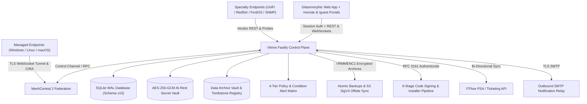

# Vitrine RMM

<p align="center">
  
</p>

<p align="center">
  <strong>Modern, glassmorphic self-hosted RMM powered by MeshCentral 2 — engineered for NinjaRMM feature parity and beyond.</strong><br/>
  Zero-trust fleet orchestration with silent background tools, 4-tier cascading policy & alert governance, Data Archive Vault offboarding, vendor-native specialty appliance APIs, AES-256-GCM encrypted backups, and low-latency remote control.
</p>

<p align="center">
  <a href="https://github.com/TylerHats/Vitrine-RMM/releases/latest"></a>
  <a href="https://github.com/TylerHats/Vitrine-RMM/wiki"></a>
  <a href="https://hub.docker.com/r/tylerhats/vitrine-rmm"></a>
  <a href="LICENSE"></a>
</p>

---

## 📖 Detailed Documentation (GitHub Wiki)

All deep architectural guides, API references, security specifications, and setup walkthroughs are maintained in the [**GitHub Wiki**](https://github.com/TylerHats/Vitrine-RMM/wiki):

*   [**Installation & Setup**](https://github.com/TylerHats/Vitrine-RMM/wiki/Installation-and-Setup) — System requirements (Node.js 20+), bare-metal `systemd` setup (safe alongside existing `/opt/meshcentral`), Docker Compose deployment, First-Run Super Admin bootstrap, and Reverse Proxy / Let's Encrypt TLS OOBE Wizard.
*   [**Architecture & Security**](https://github.com/TylerHats/Vitrine-RMM/wiki/Architecture-and-Security) — Scrypt authentication, `HttpOnly` session cookies, strict multi-tenant RBAC (`super_admin`, `technician`, `client_admin`), AES-256-GCM at-rest secret vault, RFC 6238 Step-Up TOTP MFA (with anti-replay & single-use recovery codes), Scoped Vendor Guest Portal, and Cyber Isolation.
*   [**Offboarding & Data Archive Vault**](https://github.com/TylerHats/Vitrine-RMM/wiki/Offboarding-and-Archive-Vault) — Clean endpoint & client offboarding, offline queue & auto-archive rules, preserved BitLocker/LAPS Data Archive Vault, automatic resurrection on wake/reinstall, and deleted-client tombstones for quiet self-offboarding.
*   [**Hierarchical Policy & Condition Alerting Engine**](https://github.com/TylerHats/Vitrine-RMM/wiki/Hierarchical-Policy-Engine) — 4-tier cascading governance (`Global -> Client -> Site -> Role`), customizable LAPS local admin username & offline rotation deferral, and per-tier multi-channel state notifications (Web UI, SMTP Email, Direct PSA Ticket).
*   [**MeshCentral 2 Federation & QuickSupport Portal**](https://github.com/TylerHats/Vitrine-RMM/wiki/MeshCentral-Engine-Integration) — Multi-instance MeshCentral 2 federation, customer-facing QuickSupport portal (`/remote`), 6-stage Authenticode signing pipeline, zero-touch Intel AMT/vPro CIRA, and 5-tier peer-relayed Wake-on-LAN.
*   [**Specialty Endpoints, Vendor APIs & Network Topology**](https://github.com/TylerHats/Vitrine-RMM/wiki/Network-Discovery-and-Topology) — Vendor-native polling for Ubiquiti UniFi OS, DMTF Redfish (Dell iDRAC / HPE iLO / Supermicro BMC), FortiOS, Synology DSM, APC NMC3, VoIP PBXs, Printers, and generic SNMP/TCP/TLS probes — complete with an interactive step-by-step setup wizard.
*   [**Backups, Self-Updater & Disaster Recovery**](https://github.com/TylerHats/Vitrine-RMM/wiki/Backups-Updates-and-Maintenance) — Unified AES-256-GCM encrypted `.vrmm-backup.gz` (`VRMMENC1`) archives, live atomic SQLite Backup API snapshots, AWS Signature V4 S3/R2/MinIO/B2 offsite sync, schema-aware restore, and Stable/Alpha self-updater with automatic rollback.
*   [**Silent Background Management Suite**](https://github.com/TylerHats/Vitrine-RMM/wiki/Background-Management-Suite) — Background PowerShell/Bash PTY shells, Process & Services manager, Remote Registry/Config editor, Dual-Pane File Manager, Event Logs, and Task Scheduler.
*   [**Patch Management & Deployments**](https://github.com/TylerHats/Vitrine-RMM/wiki/Patch-Management-and-Deployments) — OS & 3rd-party patching, NVD CVE/CVSS v3.1 scoring, OEM driver catalogs, and KB rollback.
*   [**Self-Healing & Script Orchestration**](https://github.com/TylerHats/Vitrine-RMM/wiki/Self-Healing-and-Automations) — Condition watchdogs with circuit-breaker flap protection, RBAC script library, and `$vitrine.*` runtime token injection.
*   [**Two-Way PSA & REST API**](https://github.com/TylerHats/Vitrine-RMM/wiki/Two-Way-PSA-and-REST-API) — Bidirectional ITFlow ticketing, HMAC-SHA256 authenticated webhooks, and Executive QBR reporting.

---

## 🛠️ High-Level System Architecture



---

## ⚡ Quick Start

### 1. Requirements
*   **Operating System**: Linux (Debian 12+ or Ubuntu 22.04/24.04 LTS recommended) or any Docker host.
*   **Runtime**: Node.js **20+** & npm (for bare-metal); Docker 24+ & Docker Compose v2+ (for containerized deployments).
*   **Existing MeshCentral Safety**: `install.sh`, `uninstall.sh`, and the runtime engine strictly isolate all Vitrine files to the repository directory (`./data`, `./branding`, `./dev-meshcentral`) and **never** modify or write to an existing `/opt/meshcentral` installation.

### 2. Docker Compose Deployment (Recommended)
```bash
git clone https://github.com/TylerHats/Vitrine-RMM.git
cd Vitrine-RMM
docker compose up -d
```
Or pull the official prebuilt image directly from Docker Hub (`tylerhats/vitrine-rmm:2.5.0` / `tylerhats/vitrine-rmm:latest`). See [`DOCKER_README.md`](DOCKER_README.md) for full volume and environment details.

### 3. Automated Bare-Metal Installation (`systemd`)
```bash
git clone https://github.com/TylerHats/Vitrine-RMM.git
cd Vitrine-RMM
./install.sh
```
`install.sh` verifies Node.js 20+, builds production frontend & backend bundles, locks down `./data` permissions (`chmod 700`), and optionally installs/restarts `vitrine-rmm.service`.

### 4. First-Run Bootstrap & OOBE Wizard
Open `http://localhost:8080/` in your browser:
1. **Create Your Initial MSP Super Admin**: On a fresh database, Vitrine starts completely clean (zero demo records or hardcoded accounts) and presents the **Initial Super Admin Bootstrap** screen, enrolling your RFC 6238 TOTP authenticator secret and generating **8 single-use emergency recovery codes**.
2. **Guided Setup Wizard**: Configure white-label branding, Reverse Proxy & TLS domain (`Nginx`, `Caddy`, `Traefik`, or `Cloudflare Tunnel`), MeshCentral 2 connection, SMTP notifications, and optional PSA integration.

---

## 🛡️ Comprehensive Feature Matrix (v2.5.0 Stable)

1. **Zero-Trust Authentication, RBAC & At-Rest AES-256-GCM Vault**:
   * **Scrypt Password Auth + `HttpOnly` Sessions**: Memory-hard scrypt (`N=16384`) password hashing, database-backed revocable sessions (`SameSite=Lax`, `HttpOnly`), and brute-force rate limiting.
   * **Strict Multi-Tenant RBAC**: Enforces server-side tenant isolation across `super_admin`, `technician`, and `client_admin` roles on every API route and WebSocket stream.
   * **AES-256-GCM Secret Encryption & Step-Up TOTP MFA**: Encrypts LAPS passwords, BitLocker/LUKS/FileVault recovery keys, MeshCentral tokens, SMTP/PSA credentials, specialty API keys, and backup keys at rest (`enc:v1:...`). Revealing LAPS, BitLocker, or Break-Glass exports requires RFC 6238 TOTP Step-Up MFA with strict 30-second time-step anti-replay protection and single-use hashed recovery codes.
2. **Customizable LAPS Local Admin & Offline Rotation Deferral**:
   * Customize the managed local administrator username (`laps_account_name`, e.g. `ClientITAdmin`) across Global, Client, Site, and Role policy tiers, plus generate offline **Break-Glass LAPS Exports** (MFA-gated).
   * **Offline Lockout Protection**: Scheduled LAPS rotations automatically **defer** (`rotation_pending_online = 1`) whenever an endpoint is offline — and **skip** if offboarding is pending — ensuring Vitrine never overwrites its vaulted password before the endpoint confirms local OS password rotation.
3. **Clean Endpoint & Client Offboarding + Data Archive Vault**:
   * **Online Clean Offboard & Offline Queueing**: Reverts policies, handles the managed local admin account per 3 contextual policy rules (`Explicit Device Offboard`, `Client Archived`, `Client Deleted`), and cleanly removes agent software on online endpoints while queueing offline endpoints (with force-archive and auto-archive-after-X-days options).
   * **Data Archive Vault**: Preserves offboarded endpoints and archived clients in their last-known state — keeping BitLocker keys and LAPS histories accessible months or years later unless explicitly purged.
   * **Wake Resurrection & Deleted-Client Quiet Offboarding**: Archived endpoints under active clients automatically resurrect if they wake up or reinstall; endpoints belonging to archived or permanently deleted clients match the **Tombstone Registry** and quietly offboard themselves without resurrecting orphan records.
4. **4-Tier Cascading Policy & Condition Notification Matrix**:
   * Configure threshold-based fleet condition rules across Global, Client, Site, and Role tiers (`Endpoint Offline > X Days`, `Disk Space Critical`, `CPU Sustained High`, `RAM Critical`, `Pending Reboot Overdue`, `BitLocker Unprotected`, `EDR Inactive`, `S.M.A.R.T. Failing`, `Specialty Appliance Offline`, `WAN SSL Expiring`, `Network/Hardware Drift`) with independent per-channel routing (**Web UI Bell**, **SMTP Email**, and **Direct PSA Ticket Creation**) and deduplication cooldowns.
5. **Specialty Endpoints, Vendor REST APIs & Interactive Setup Guides**:
   * Native vendor API & probe integrations for **Ubiquiti UniFi OS** (`UDM-Pro`, switches, APs), **Out-of-Band BMCs via DMTF Redfish** (`Dell iDRAC 9`, `HPE iLO 5/6`, `Supermicro BMC`), **Fortinet FortiOS**, **Synology DSM**, **APC Smart-UPS NMC3**, **VoIP PBXs**, **Printers/MFPs**, **Badge/NVR Controllers**, and **WAN SSL/TLS Expirations**, paired with a step-by-step **Vendor Setup Walkthrough Modal**.
6. **Multi-Instance MeshCentral Federation, QuickSupport (`/remote`) & Authenticode Pipeline**:
   * Federate multiple isolated MeshCentral 2 instances per client/region, host a branded customer-facing **QuickSupport Portal (`/remote`)** with 6-digit session codes, and sign agent installers via a 6-stage Authenticode / Cloud HSM pipeline (`osslsigncode`, Azure Trusted Signing, AWS KMS, DigiCert, SignPath).
7. **Interactive KVM, Headless Ghost Desktops, Silent Background Tools & 5-Tier Peer WoL**:
   * Low-latency WebRTC KVM, zero-interference Headless Ghost sessions, Intel AMT/vPro hardware KVM, background SYSTEM/User PTY shells, Process/Service/Registry/File/Event/Task managers, CVE patch orchestration, and 5-tier subnet-peer Wake-on-LAN.
8. **Unified Encrypted Self-Backups (`VRMMENC1`) & Self-Updater (`Stable` / `Alpha`)**:
   * Atomic hot SQLite snapshots (`better-sqlite3` `.backup()`) bundled with the vault key and branding into AES-256-GCM encrypted `.vrmm-backup.gz` archives, optional S3-compatible AWS SigV4 offsite uploads, schema-aware live restore, and built-in GitHub `Stable`/`Alpha` self-updates with pre-update backup and automatic build-failure rollback.

---

## 🧹 Clean Uninstallation

To stop background services, remove build artifacts, and optionally purge local Vitrine data vaults (leaving any neighboring `/opt/meshcentral` untouched):
```bash
./uninstall.sh
```

---

## 📄 License

Vitrine RMM is open source licensed under the **GNU General Public License v3.0 (GPL-3.0)**. See [LICENSE](LICENSE) for details.
