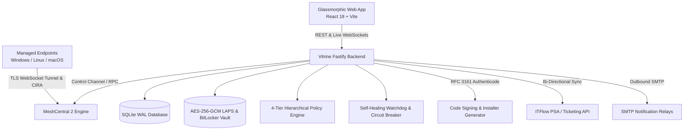

# Vitrine RMM

<p align="center">
  
</p>

<p align="center">
  <strong>Modern, glassmorphic self-hosted RMM powered by MeshCentral 2 — engineered for NinjaRMM feature parity and beyond.</strong><br/>
  Complete fleet orchestration with silent background tools, hierarchical policy automation, CVE patch management, zero-touch Intel vPro/AMT CIRA, and low-latency remote control.
</p>

<p align="center">
  <a href="https://github.com/TylerHats/Vitrine-RMM/wiki"></a>
  <a href="https://hub.docker.com/r/tylerhats/vitrine-rmm"></a>
  <a href="LICENSE"></a>
</p>

---

## 📖 Detailed Documentation (GitHub Wiki)

All deep architectural guides, API endpoints, agent compilation steps, and configuration tutorials are available in the [**GitHub Wiki**](https://github.com/TylerHats/Vitrine-RMM/wiki):

*   [**Installation & Setup**](https://github.com/TylerHats/Vitrine-RMM/wiki/Installation-and-Setup) — System requirements, automated bare-metal systemd installation, Docker Compose deployments, and First-Run onboarding.
*   [**Architecture & Security**](https://github.com/TylerHats/Vitrine-RMM/wiki/Architecture-and-Security) — Multi-tenant isolation, OpenID Connect / Authentik SSO, RFC 6238 TOTP Step-Up MFA, AES-256-GCM LAPS credential vault, Vendor Guest Access Portal, and cyber isolation firewalling.
*   [**MeshCentral 2 Engine Integration**](https://github.com/TylerHats/Vitrine-RMM/wiki/MeshCentral-Engine-Integration) — WebSockets & WebRTC relay bridge, zero-touch Intel AMT / vPro CIRA hardware control (with node deduplication), Tiered Wake-on-LAN peer relays, and Authenticode-signed agent generation.
*   [**Hierarchical Policy Inheritance Engine**](https://github.com/TylerHats/Vitrine-RMM/wiki/Hierarchical-Policy-Engine) — 4-tier cascading governance ($\text{Global} \rightarrow \text{Client} \rightarrow \text{Site} \rightarrow \text{Device Role}$) with tray snooze caps, transparent forced reboot HUD timers, and live Effective Policy Inspector.
*   [**Silent Background Management Suite**](https://github.com/TylerHats/Vitrine-RMM/wiki/Background-Management-Suite) — Interactive background PowerShell/Bash PTY shells, live Process & Services controller, stateful Remote Registry editor, Dual-Pane File Manager, Windows Event Viewer, and Task Scheduler manager.
*   [**Patch Management & Deployments**](https://github.com/TylerHats/Vitrine-RMM/wiki/Patch-Management-and-Deployments) — Windows Update staging, NVD CVE / CVSS v3.1 vulnerability scoring, OEM driver catalogs (Dell DCU, Lenovo Vantage, HP HPIA), Winget/Chocolatey upgrades, and DISM/WUSA KB rollback.
*   [**Self-Healing & Script Orchestration**](https://github.com/TylerHats/Vitrine-RMM/wiki/Self-Healing-and-Automations) — Condition-based watchdogs with circuit-breaker flap protection, automated PSA escalation, RBAC-scoped script library, and `$vitrine.*` runtime token injection.
*   [**Network Discovery & Topology**](https://github.com/TylerHats/Vitrine-RMM/wiki/Network-Discovery-and-Topology) — Managed agent SNMP v3 probes, subnet ARP/IP sweeps, LLDP/CDP Layer-2 switch port mapping, and agentless hypervisor lifecycle controls (Proxmox VE / VMware ESXi / Hyper-V).
*   [**Two-Way PSA & REST API**](https://github.com/TylerHats/Vitrine-RMM/wiki/Two-Way-PSA-and-REST-API) — Bidirectional ticketing synchronization with ITFlow, webhook event bus, and Executive QBR PDF reporting.

---

## 🛠️ High-Level System Architecture



---

## ⚡ Quick Start

### 1. Requirements
*   **Operating System**: Linux (Debian 12+ or Ubuntu 22.04+ recommended).
*   **Runtime**: Node.js 18 or higher & npm.
*   **Docker** (Optional for container deployments).

### 2. Automated Bootstrap Installation (Bare-Metal Service)
```bash
git clone https://github.com/TylerHats/Vitrine-RMM.git
cd Vitrine-RMM
./install.sh
```

The installer verifies prerequisites, compiles the production frontend and backend bundles, initializes and seeds the SQLite WAL database, and optionally installs and starts a `vitrine-rmm.service` systemd background daemon.

To start manually:
```bash
PORT=8080 node backend/dist/server.js
```

### 3. Docker Compose Deployment
```bash
docker compose up -d
```

Open `http://localhost:8080/` in your browser to launch the platform and begin onboarding with the built-in Setup Wizard.

---

## 🛡️ Comprehensive Feature Matrix (NinjaRMM Parity & Beyond)

1. **Modern Glassmorphic Web UI & Global Quick-Jump (`Ctrl+K`)**: Native dark/light themes, customizable brand accent color and backdrop blur presets (`high`/`medium`/`low`), and instant keyboard-driven endpoint search.
2. **Dynamic Smart Groups & Bulk Fleet Orchestration**: Filter endpoints by built-in or custom query rules (`cpu_usage > 70`, `pending_reboot = 1`, `edr_status != Active`), run bulk patch scans, and export filtered inventory to CSV.
3. **4-Tier Hierarchical Policy Inheritance Engine**: Cascading policies ($\text{Global} \rightarrow \text{Client} \rightarrow \text{Site} \rightarrow \text{Role}$) governing telemetry rates, remote consent, LAPS rotation, tray reboot snooze limits, and transparent forced-reboot countdown HUDs.
4. **Interactive Screen Control (KVM) & Compliance Session Recording**: Low-latency WebRTC remote desktop, multi-monitor switching, pause/resume server-side compliance recording, and stealth recording modes.
5. **"Ghost Session" (Headless Remote Desktop)**: Secondary graphical admin session allowing visual GUI administration without disturbing the end-user's physical screen.
6. **Silent Background Management Suite**:
   * **Interactive Background Shells**: Multi-tab WebSocket PowerShell, CMD, and Bash consoles executing as `SYSTEM`/`root`.
   * **Live Process & Services Manager**: Real-time process tree termination and Windows Services (`Start`/`Stop`/`Restart`) control.
   * **Stateful Remote Registry Editor**: Browse hives (`HKLM`, `HKCU`) and create, modify, or delete registry values silently.
   * **Dual-Pane Remote File Manager**: Navigate directories, create folders, delete files, and stage transfers in the background.
   * **Windows Event Log Viewer & Task Scheduler**: Filter System/Security/Application logs and trigger, enable, or disable scheduled tasks.
7. **Zero-Trust LAPS & BitLocker Vault with Step-Up TOTP MFA**: AES-256-GCM encrypted Local Administrator Password Solution and BitLocker recovery key escrow protected by RFC 6238 TOTP Step-Up MFA verification and post-access auto-rotation.
8. **Scoped Vendor / Guest Access Portal**: Generate time-bound, permission-scoped access links (`/?guest_token=<id>`) with temporary credentials and live countdown timers for third-party contractors.
9. **Tokenized & Authenticode-Signed Agent Installers**: One-liner PowerShell, Bash, and macOS deployment commands (`/api/agent/deploy` & `/api/agent/download`) with automated Authenticode code signing and PSA ticket audit logging.
10. **Tiered Wake-on-LAN & Zero-Touch Intel vPro / AMT CIRA**:
    * **Tiered WoL**: Automatically elects online peer agents on the target subnet to broadcast UDP magic packets locally.
    * **OS & WMI BIOS Enabler**: Remotely enables NIC Magic Packet wake, disables Windows Fast Startup power-cut, and configures Dell/HP/Lenovo WMI BIOS settings without rebooting.
    * **Intel vPro / AMT Auto-Provisioning**: Activates CIRA out-of-band power and hardware KVM while preserving unified node deduplication.
11. **OS, Third-Party (Winget/Choco), & CVE Vulnerability Management**: NVD CVE/CVSS v3.1 risk scoring, one-click Winget application remediation, bulk patch approvals, canary deferral rules, and DISM/WUSA KB rollback.
12. **Self-Healing Watchdogs with Circuit-Breaker Flap Protection**: Event-driven monitors that auto-execute remediation scripts, track hourly run counts, trip circuit breakers on flapping endpoints, and escalate to PSA tickets.
13. **Hardware Delta Auditing, Network Drift Watchdog & OEM Warranty**: Tracks PCI/SMBIOS hardware changes (Micron, Samsung, NVIDIA, Intel), flags unauthorized subnet/SSID drift, and queries OEM warranty entitlements.
14. **Layer-2 Network Discovery & Virtualization Management**: SNMP v3 switch port LLDP/CDP neighbor mapping, subnet ARP sweeps, and agentless VM power/snapshot controls for Proxmox VE, VMware ESXi, and Hyper-V.
15. **Bidirectional MeshCentral Sync, Two-Way PSA (ITFlow) & Executive QBRs**: Syncs MeshCentral device groups with Vitrine Clients, synchronizes PSA service tickets, and generates print-ready Executive QBR health reports.

---

## 🧹 Clean Uninstallation

To cleanly stop background services, remove build caches, and optionally purge data vaults, run:
```bash
./uninstall.sh
```

---

## 📄 License

Vitrine RMM is open source licensed under the **GNU General Public License v3.0 (GPL-3.0)**. See [LICENSE](LICENSE) for details.
